<div align="center">

# TW Editor

**A fast, modern DDNet map editor that runs in your browser.**

Open your `.map`, draw, press Ctrl+S, and it is saved back into the same file.
On top of everything the DDNet editor does, it can design a whole map for you, turn pictures into quad art,
animate quads with keys and test the map on a local server in one click.

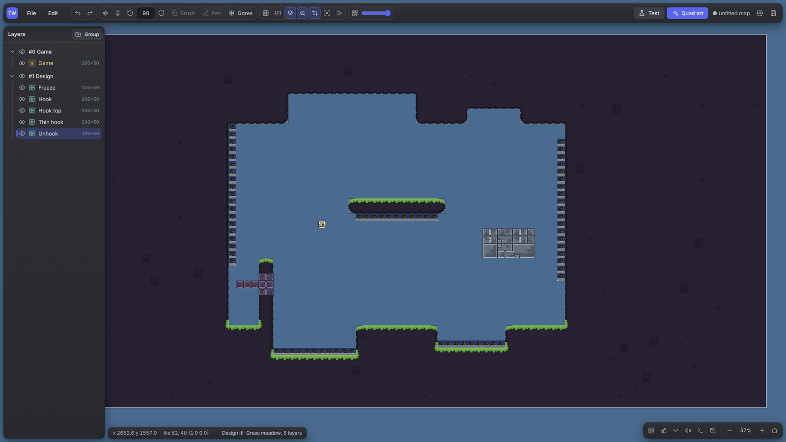

[Quick start](#quick-start) · [Highlights](#highlights) · [Everything it can do](#everything-it-can-do) · [Shortcuts](#shortcuts) · [Modules](#modules) · [For developers](#for-developers)

</div>

---

## Quick start

### Portable (nothing to install)

1. Download `tw-editor-<version>-win64.zip` from [Releases](../../releases) and unpack it anywhere.
2. Double-click **`start.bat`**. Python and every module are already inside (`runtime\`).
3. The editor opens in your browser at `http://localhost:8765`.

The portable build updates itself: on every start it checks the latest release and downloads only the changed code
(1 to 2 MB). The large runtime is downloaded again only when the Python modules change. Your settings, rules and the
local test server are never touched. Turn updates off with `"auto_update": false` in `config.json` or `start.bat --no-update`.

### From source

1. Install [Python 3](https://www.python.org/downloads/) and tick **"Add python.exe to PATH"**.
2. Clone or download this repository and double-click **`start.bat`**.
   The first start installs the quad art modules (numpy, pillow, opencv, mapbox-earcut, scipy).
3. Or run it by hand: `python editor.py` (`--port 9000`, `--no-browser`, `--keep-running`).

> **Use Chrome or Edge.** There Ctrl+S writes straight back into the opened `.map` file. Firefox downloads the map instead.

The editor finds your DDNet installation by itself (Steam too) and takes the standard mapres, entities and automapper
rules from it. Without DDNet installed they are downloaded once from DDNet's GitHub into `cache/`. Another game folder
can be set in **Edit → Editor settings**.

If port 8765 is taken, the editor picks the next free one and remembers it, so the address (and with it the browser's
palette and autosave) stays the same every time. Closing the last editor tab stops the editor about 8 seconds later.

---

## Highlights

### ✨ Design it!: a finished map look in one click

Right click the **Game** layer and press **Design it!**. The editor draws your whole map with real tilesets: one
automapped layer for every kind of tile, in a new **Design** group right above Game. The preview shows *your own map*
around the spawn, so you see the result before you apply it.

| Grass meadow | Generic stones | Amazing Flat |
|:---:|:---:|:---:|
| 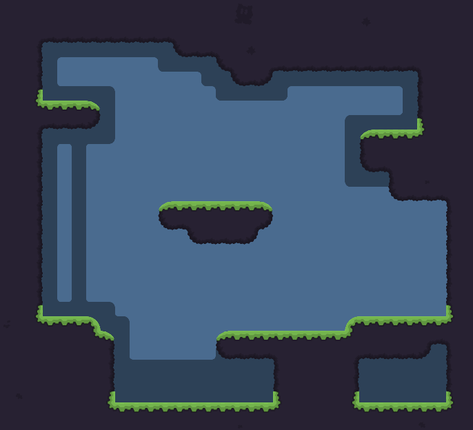 | 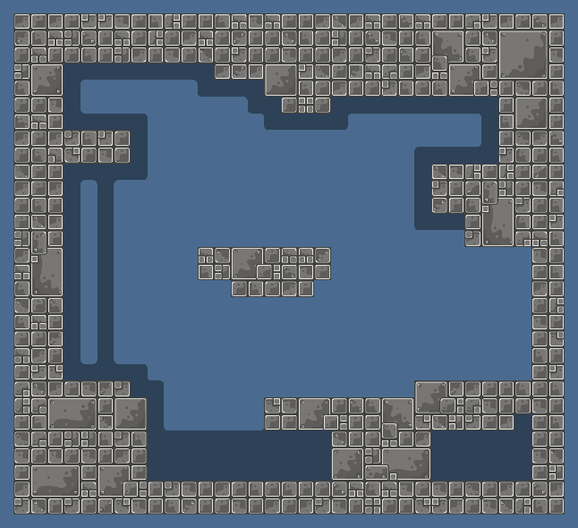 | 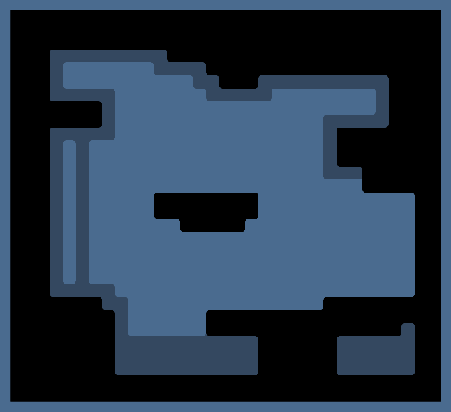 |
| `meadow_obsidian` ground with a grass edge, stones for thin parts and unhook | `Stones07_GreyMix_Sharp` for everything solid, unhook in steel blue | Flat `amazing_freeze` blocks with soft corners everywhere |

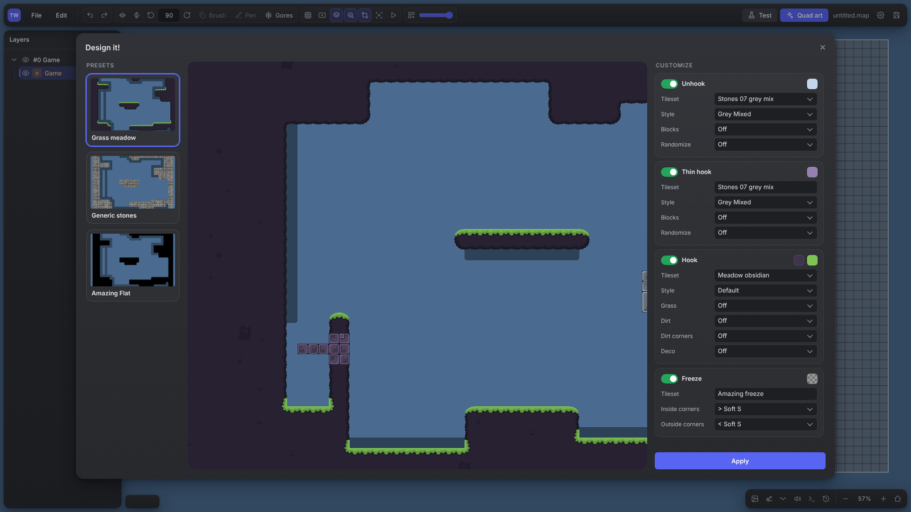

- **Presets** on the left fill in every setting. **Customize** on the right changes anything per kind: tileset, style,
  extra passes (grass, dirt, deco, blocks, randomize, corner styles) and colours (click a swatch).
- Kinds it draws, bottom to top: **Freeze** (alpha 100, under everything), **Unfreeze**, **Death**, **Tune**, **Tele**,
  **Hook**, **Thin hook**, **Unhook**, **Hookthrough**. Only kinds that exist on your map get a layer; each kind can be switched off.
- **Thin hook**: `meadow_obsidian` cannot draw 1 tile thick walls, so a stones layer fills exactly those spots.
- **Hookthrough** (unhook + tile 66 in Front) gets its own layer on top.
- Unfreeze, tele and tune use the freeze tileset, tinted green, blue and purple; death is plain red.
- Tilesets that are not part of DDNet (`amazing_freeze`, `meadow_obsidian`, `Stones07_GreyMix_Sharp`) ship in
  `extra-data/` and are **embedded into the map**, so it works on any server.
- One undo step. Every layer keeps its automapper config and seed, so it can be re-run from the layer menu after you edit the map.
- If a Design group already exists, you choose **Replace** or **Add another**.

<details>
<summary>The other two presets on the same map</summary>

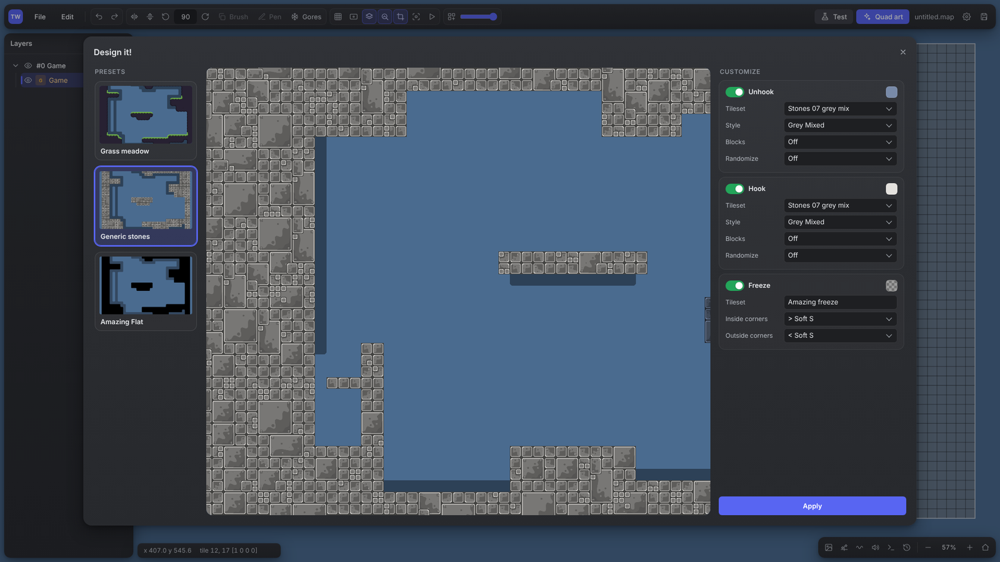
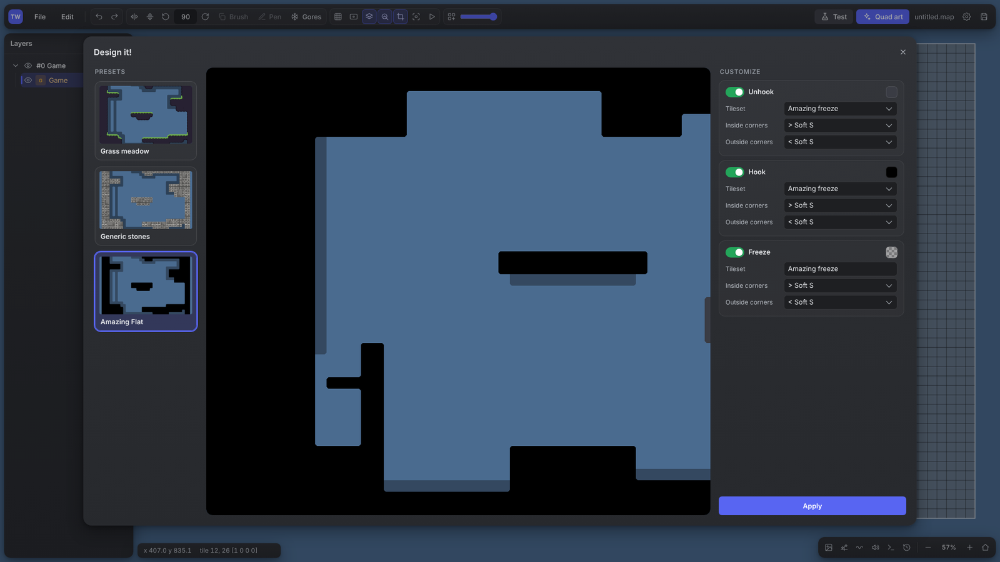

</details>

### ⚡ Fast automapper

A full port of DDNet's `auto_map.cpp` with the same results (same random variants for the same seed), made much faster:
each rule is compiled once into lookup tables, and only the rules that can match an empty or a filled cell are tried.
Configs, seeds, reference layers and **automatic mode** (re-run while you paint) are supported.

### 🎨 Quad art from an image

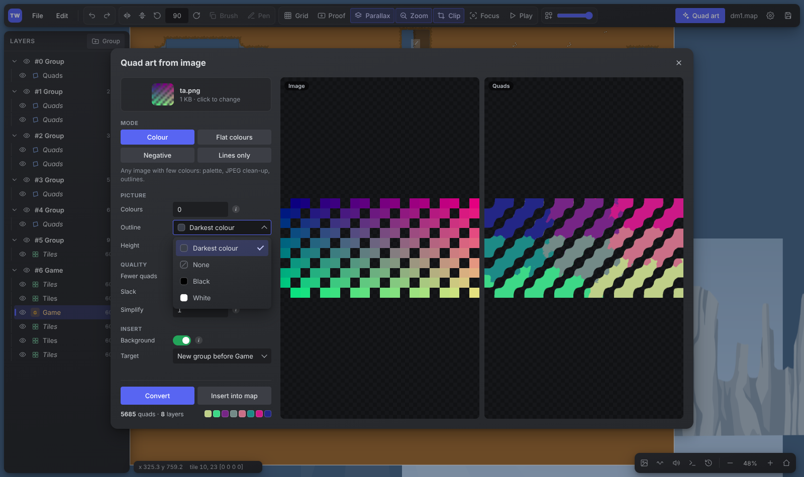

Drop a picture and get it as **coloured quads**, one layer per colour. The converter (`img2quads.py`) quantizes the image,
cleans JPEG noise, traces the outlines with holes, triangulates them and pairs the triangles into quads, so there are no seams.

- Modes: **Colour**, **Flat colours** (pixel art and prepared pictures), **Negative** (ink drawing as light lines on
  a dark background), **Lines only**.
- **Fewer quads** merges what can be merged.
- Inserted as a new group before Game, or into the selected group. Image and quads are shown side by side.
- Also available as a command line tool: `python img2quads.py picture.png out.map --preview out.png`.

**Tile art** does the same with tiles: one pixel = one tile.

### ✏️ Quad pen

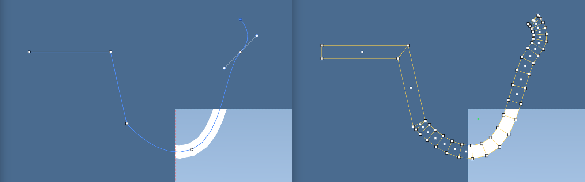

Press **D** on a quads layer and draw strokes like in a vector editor: click for points, drag for curves. Every straight
segment is one quad, curves are cut into trapezoids (subdivisions per path or per point). Sharp corners get a bevel quad;
**Alt** moves or removes a single handle; click the first point to close the path. Width, colour and subdivisions live in
the right panel and are remembered.

**Fill** *(experimental)* closes the path and moves the inner corners of its quads into the shape, so the inside is
covered without a single extra quad:

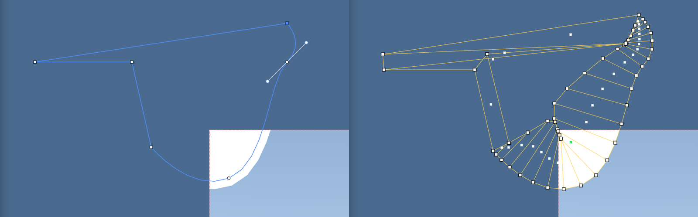

### 🎬 Timeline: animate quads with keys

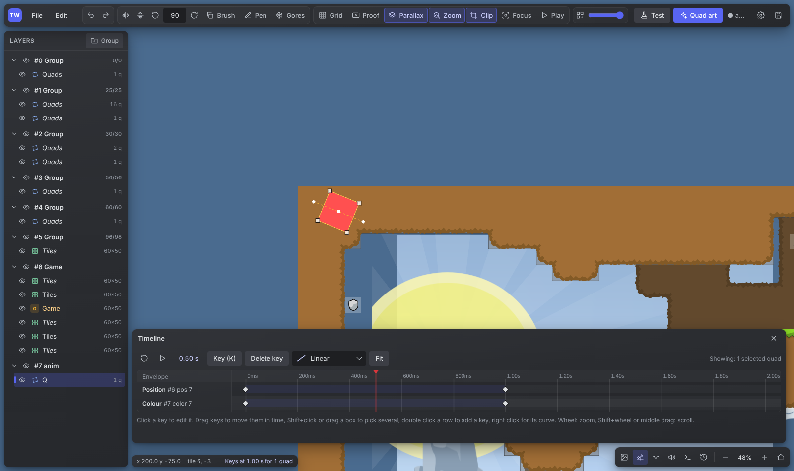

Press **K** with quads selected to key their position, rotation and colour at the playhead. Move the playhead, move or
turn the quads (shown in orange until keyed, with the motion path drawn) and press **K** again. Keys can be dragged,
box-selected, deleted, given a curve (Step, Linear, Slow, Fast, Smooth) or typed in. Everything is stored as normal
DDNet envelopes, so the map stays 100% compatible.

### 🧪 Test the map in one click

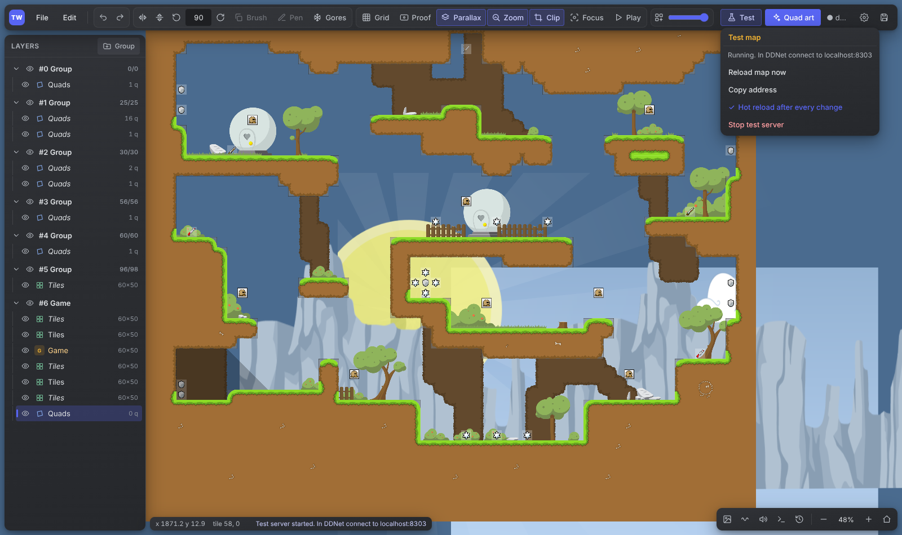

**Test** starts the editor's own DDNet server with your map. Connect from your client (`localhost:8303`, it also shows
in the Local tab). Every Ctrl+S sends the map with `hot_reload`, so tees stay where they are. The server is downloaded
once and ignores your own DDNet config, votes and maps.

### ❄️ Gores mode

Press **G** and paint: every hookable tile gets a freeze ring around it, erasing hook removes the freeze it placed, and
carving air through a hook wall turns the touched hook into freeze. Only tiles next to your edit change, and freeze you
placed by hand is never removed.

---

## Everything it can do

<details open>
<summary><b>Maps and files</b></summary>

- Opens and saves DDNet `.map` files completely: envelopes with bezier curves, automapper settings and unknown UUID items are kept.
- **Own Open / Save window** that reaches `%APPDATA%\DDNet\maps` (the browser's dialog refuses AppData), with DDNet maps
  one click away, recent files, and Ctrl+S writing back to the same file anywhere on the computer.
  **Browser dialog…** still opens the browser's own.
- **Session restore**: the last map, its unsaved changes, the view and the open tab come back after a page reload.
- History with a jump to any step, **Append from another map**, server settings, map details, sounds (`.opus`).
- Images: embedded PNG (JPG, WEBP, GIF, BMP are converted automatically), drag and drop files onto the window or
  straight onto the map (a dropped image gets its own quads layer), external mapres, replace, rename, embed / make external,
  export, delete unused. The layer image picker shows a searchable grid of previews.
- A spinner in the status bar shows what is running (opening, saving, test server, quad art).

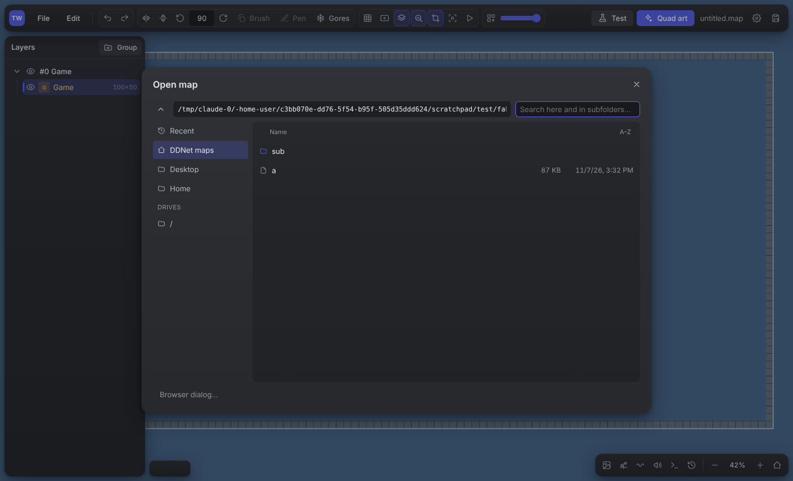

</details>

<details>
<summary><b>Tiles and physics layers</b></summary>

- Tile, Game, Front, Tele, Speedup, Switch and Tune layers drawn with the DDNet editor's pictures, with tele / switch / tune
  numbers and speedup arrows at their angle.
- Tile picker while **Space** is held (or pinned open with the Tile picker button), brush from a selection, flip and rotate
  the brush (N, M, R, T), rectangle fill (Shift), flood fill (Ctrl+Shift), destructive mode, DDNet tile validity rules.
- **Several tile layers at once**: Ctrl/Shift+click layers in the list; select, brush, fill and erase then work in all
  of them in one undo step.
- **Resize with an anchor**: a 3x3 anchor picks the sides to grow on, everything built stays in place, all physics layers
  resize together, quads, sound sources and parallax offsets move with it. **Linked** also resizes every lined-up tile
  layer of the same size; a dashed frame previews the new size.
- Border, construct and clean up game tiles.

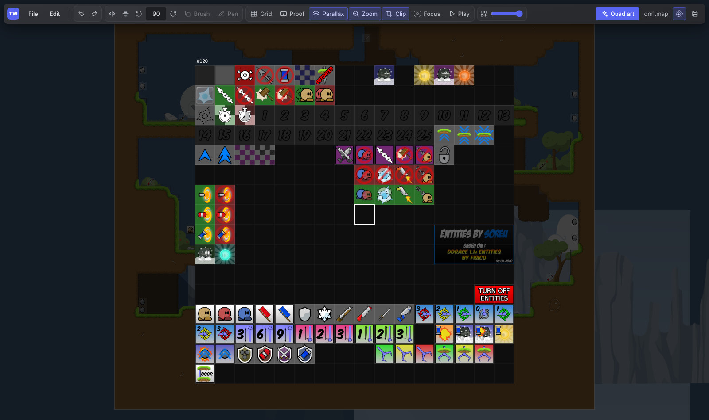
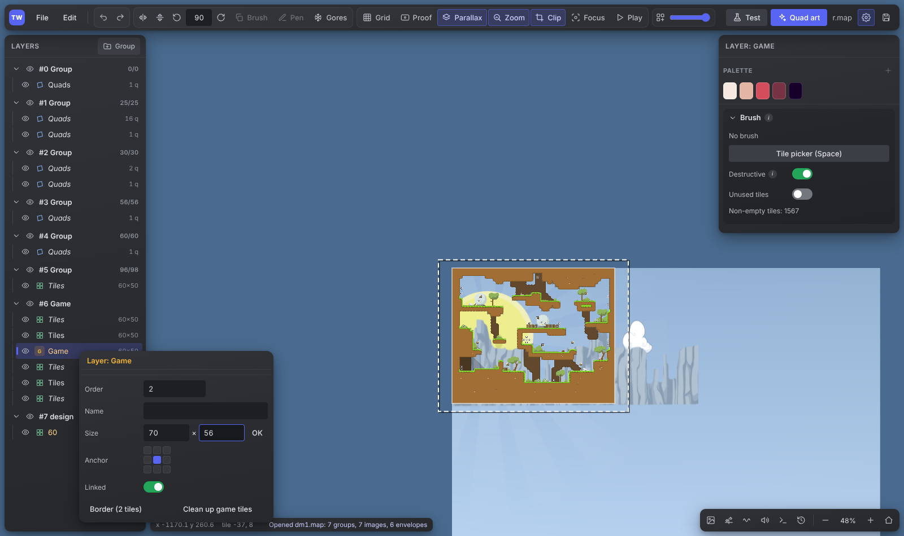

</details>

<details>
<summary><b>Quads</b></summary>

- Select, box select (also on top of other quads), drag (Shift locks the axis), corner points, pivot (Ctrl), corner colours,
  texture coordinates, position and colour envelopes, square, align, image aspect ratio, flip, copy / paste / duplicate, order, knife.
- **Rotate** (hold R and move the mouse) and **scale** (hold S) with Shift for fine and Ctrl for steps; Esc cancels.
- **Quad brush** (B): grab quads and stamp copies with clicks or drags.
- **Concave quads stay correct**: DDNet splits a quad along TL-BR, so some concave quads would fill outside their outline.
  The editor renames the corners so the fill always stays inside.
- **Grid snapping** with finer grids as you zoom in (half, quarter… of a tile, down to 1 unit).

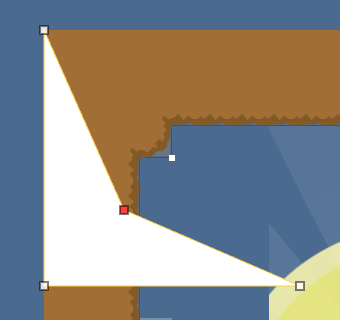

</details>

<details>
<summary><b>Colours and palette</b></summary>

- A **colour palette** at the top of the right panel, kept in the browser. Every colour you copy lands there: the pipette
  (Ctrl+Shift+C), Shift+right click on a colour, Ctrl+C of a hex code. **+** saves the colours of the selection, and a quad
  with different corners is saved as a **gradient** that is applied corner by corner.
- Drag swatches to reorder, right click to copy as hex or remove. Palette changes are undoable but never mark the map unsaved.
- Every colour field takes `#RRGGBB`, `#RRGGBBAA`, `F80`, `r g b [a]` or `rgb(...)`. Own colour picker window.

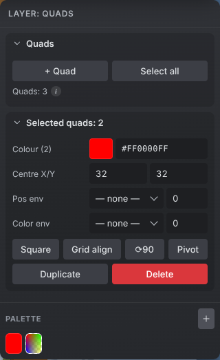

</details>

<details>
<summary><b>Envelopes, sounds and view</b></summary>

- Envelopes: colour, position and sound, a graph with draggable points and curves, synchronization, animation preview (▶).
- Sound layers and sources: circle and rectangle shapes, falloff, loop, pan, delay, envelopes.
- View: grid, proof (game screen frame), parallax and parallax zoom, clipping, entities opacity, focus on a layer, tile info (Ctrl+I).

</details>

<details>
<summary><b>Interface</b></summary>

- The map fills the whole window and the panels float over it as islands. Discord-like dark theme, solid panels with no
  blur, so even a busy map stays fast.
- Right-click menus like in the DDNet editor for groups, layers, eyes, quads, corners, sound sources, images, sounds and
  envelope points. Layer and group settings live in their right-click menus; the properties panel (P) holds only the tools.
- Shift+click a group or layer eye to see only it; Shift+click again brings everything back.
- Every number field can be dragged left / right (Shift fine, Ctrl coarse), one undo step per drag.
- Resizable, collapsible panels, short help behind every "i" mark, layers and groups reordered by dragging.
- Hotkeys follow the physical key, so they work with a Russian or any other keyboard layout.

</details>

<details>
<summary><b>Learned styles (command line)</b></summary>

`tools/tilestyle.py` learns a tile style from a finished, hand-designed map: for every air and freeze cell it remembers
the stack of freeze and decoration tiles used in that neighbourhood, so a new map can be decorated the same way.

```
python tools/tilestyle.py learn designed.map styles/<name> [--spec spec.json]
```

Learned styles are kept in `styles/<name>/`; the editor server lists them at `/api/styles`.

</details>

---

## Shortcuts

Press **F1** in the editor for the full list. The most used ones:

| Key | Action | Key | Action |
|---|---|---|---|
| Space (hold) | Tile picker | Ctrl+S | Save into the same file |
| N / M | Flip brush or quads | Ctrl+Z / Ctrl+Y | Undo / Redo |
| R / T | Rotate (hold R to rotate freely) | Ctrl+O | Open |
| S (hold) | Scale selected quads | Ctrl+G / Ctrl+P | Grid / Proof |
| B | Quad brush | Ctrl+I | Tile info |
| D | Quad pen | Ctrl+Shift+C | Pipette |
| G | Gores mode | P | Properties panel |
| K | Key quads on the timeline | Home | Camera to the layer |

---

## Modules

The core editor (open and save, groups and layers, tiles, quads, sounds, envelopes, images, automapper, undo, session
restore) works on its own. Every extra feature is a **module**: one file in `web/js/` with a `setup(ed)` function, listed
in [`web/js/features.js`](web/js/features.js). Delete its line (or its file) and its buttons disappear; the rest keeps working.

| id | What | Files | Server side |
|---|---|---|---|
| `palette` | Colour palette | `palette.js` | |
| `colorpicker` | Own colour picker window | `colorpicker.js` | |
| `tilenumbers` | Tele / switch / tune numbers, speedup arrows | `tilenumbers.js` | |
| `gores` | Gores mode (G) | `gores.js` | |
| `pen` | Quad pen (D) and its Fill | `pen.js`, `pen-fill.js` | |
| `timeline` | Timeline with keys (K) | `timeline.js` | |
| `design` | Design it! | `design.js`, `web/presets/` | `extra-data/`, `styles/`, `tools/tilestyle.py` |
| `quadart` | Quad art from an image | `quadart.js` | `quadart.py`, `img2quads.py` |
| `tileart` | Tile art from an image | `tileart.js` | |
| `filedialog` | Own Open / Save window | `filedialog.js` | `filebrowser.py` |
| `testmap` | Test map on a local server | `testmap.js` | `testserver.py`, `ddnet-server/` |

`editor.py` also starts without the optional Python files; their endpoints then answer with a short error. A new module
plugs in through the hook lists in `ed.ext` (see the Editor constructor in `web/js/editor.js`): commands, keys, overlays,
tile edits, bottom tabs, layer menu buttons and save targets.

---

## For developers

```
editor.py          local server: serves web/, DDNet data, quad art, rules, file browser
web/               the editor itself (plain ES modules, no build step)
  js/main.js       start-up and modules        js/map.js        .map format
  js/render.js     WebGL renderer              js/editor.js     tools
  js/panels.js     panels                      js/automapper.js DDNet automapper
extra-data/        tilesets and .rules that are not part of DDNet
tools/             command line tools (tilestyle, twmap)
portable/build.py  builds the portable Windows zip
update.py          self-update of the portable build
```

**Making a release**: push a tag like `v1.0.0` (or run *Actions → Release* by hand). The workflow builds the portable
zip, the code-only zip for updates and `version.json`, and publishes them as a GitHub release. The Python runtime gets
its own release and is rebuilt only when `portable/requirements.txt` or the Python version change.

---

<div align="center">

Made for the DDNet community. Maps made with TW Editor are plain DDNet maps and open in the official editor.

</div>
