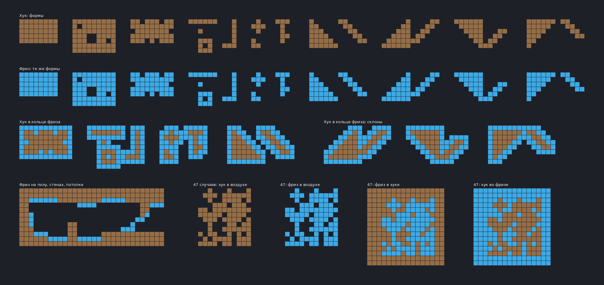

# Шаблон для своих .rules

`rules_template.map` — одна карта-шаблон. В её Game layer уже стоят хук и фриз во всех нужных
сочетаниях. Ты раскрашиваешь шаблон любыми mapres (amazing_freeze, grass_main, свои картинки),
а `tools/template2rules.py` смотрит, какой тайл ты поставил в какой ситуации, и пишет из этого
`.rules` для автомаппера DDNet.



## 1. Раскрасить

1. Открой `templates/rules_template.map` в tw-editor (или в редакторе DDNet). Game layer не трогай.
2. Над Game лежит группа **Design** с двумя пустыми слоями:
   - **Freeze**, картинка amazing_freeze (вшита в карту);
   - **Hook**, картинка grass_main.
   Картинку слоя можно сменить на любую. Можно добавить свои слои: **каждый тайловый слой станет
   отдельным конфигом**, а имя слоя станет именем конфига.
3. Рисуй тайлы в слоях так, как хочешь видеть карту:
   - на клетках хука и фриза;
   - в воздухе рядом, если нужно (трава над землёй, тени, края фриза снаружи);
   - под хуком, если нужно (как amazing_freeze подкладывает фриз под края хука).
   Пустая клетка означает «тут ничего не ставить».
4. Если в одной и той же ситуации поставить разные тайлы (например, три вида травы на ровном верху),
   скрипт сделает случайный выбор между ними с теми же долями.
5. Разделы шаблона (см. картинку): простые формы хука, те же формы из фриза, хук в кольце фриза
   (как в gores), склоны, фриз на полу/стенах/потолке, и четыре «лабиринта» 12×12, в которых
   есть все 47 вариантов соседства: хук в воздухе, фриз в воздухе, фриз внутри хука, хук внутри фриза.
   Чем больше разделов раскрашено, тем точнее правила.

## 2. Получить .rules

Перетащи сохранённую карту на `tools/template2rules.bat`, или:

```
python tools/template2rules.py templates/rules_template.map
```

Рядом с картой появится папка `rules/` с файлом `<картинка>.rules` на каждую картинку
(например `amazing_freeze.rules`, `grass_main.rules`). Конфиг называется «<имя карты> <имя слоя>».
Скрипт пишет, сколько правил вышло, и где в шаблоне одна ситуация раскрашена по-разному
(там будет random: если это ошибка, исправь тайл).

Полезные ключи:

| ключ | что делает |
|---|---|
| `--symmetry` | недостающие ситуации берутся из нарисованных, повёрнутых/отражённых. Для симметричных тайлсетов (фриз). Для травы не надо: низ не равен перевёрнутому верху. |
| `--skip-unpainted` | формы, на которых и рядом ничего не нарисовано, не учитываются. Для недорисованного шаблона, вместе с `--symmetry`. |
| `--radius 2` | смотреть на 2 клетки вокруг, а не на 1 (большие скруглённые углы). Правил больше. |
| `--merge <папка>` | взять из `<папка>/<картинка>.rules` уже имеющиеся конфиги и дописать новые в конец. |
| `--out <папка>` | куда писать. |
| `--hook 1,3` | какие id игрового слоя считать хуком (по умолчанию 1; 3 = unhook). |
| `--freeze 9,12` | какие id считать фризом. |
| `--layers Hook` | только эти слои. |

## 3. Пользоваться

DDNet выбирает файл правил по имени картинки слоя, поэтому новый конфиг надо дописать в файл
с таким именем, а не заменить его:

- **amazing_freeze в tw-editor**: 
  `python tools/template2rules.py <карта> --merge extra-data/editor/automap --out extra-data/editor/automap`
  (старые конфиги amazing_freeze остаются, твой добавляется в конец).
- **Стандартные картинки (grass_main и т.п.) в клиенте DDNet**: файл в `%APPDATA%\DDNet\editor\automap\`
  заменяет встроенный целиком, поэтому пиши с `--merge "<папка DDNet>\data\editor\automap" --out "%APPDATA%\DDNet\editor\automap"`.
  tw-editor берёт правила из папки игры, так что для него `--out` должен указывать на `<папка DDNet>\data\editor\automap`.

На карте: тайловый слой с нужной картинкой, в автомаппере выбрать конфиг и **Reference = Game layer**
(или сначала скопировать в слой Game layer). Правила сами очищают всё лишнее.

## Как это устроено и где пределы

- Скрипт смотрит на 3×3 клетки (5×5 с `--radius 2`): хук (id 1, край карты тоже считается хуком),
  фриз (9, 12) или воздух (всё остальное).
- Правила идут от общего к частному: сначала «любой хук», потом по сторонам, потом углы, потом точное
  совпадение 3×3. Пишется только то, что меняет результат, поэтому ситуация, которой нет в шаблоне,
  получает тайл ближайшего более общего правила.
- Проверка: шаблон раскрашен автоматом grass_main «Default» и amazing_freeze «Sharp Tiles», выученные
  правила сравнивались с оригиналами на других картах. На platform.map совпало 99% хука и 99.6% фриза,
  на случайных пещерах 98% хука и 96% фриза (остаток в основном random-трава и редкие сочетания,
  которых нет в шаблоне). amazing_freeze «Rounded Tiles» смотрит дальше 2 клеток, его так точно не
  повторить: на пещерах около 80% даже с `--radius 2`.
- Пересобрать сам шаблон: `python tools/make_rules_template.py` (нужен Pillow, чтобы вшить amazing_freeze).
